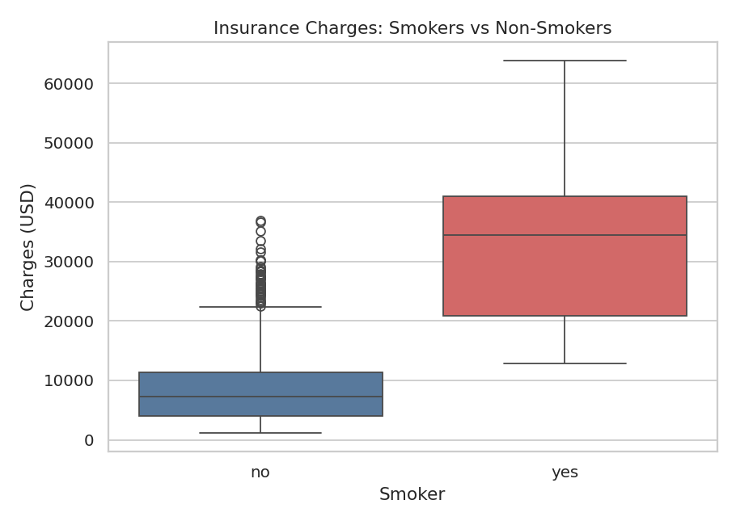
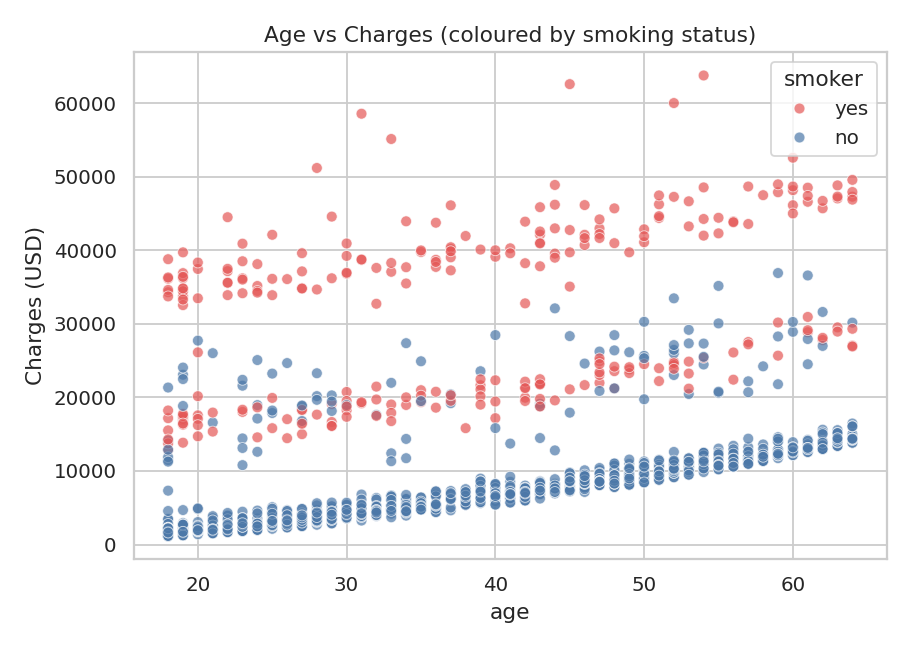
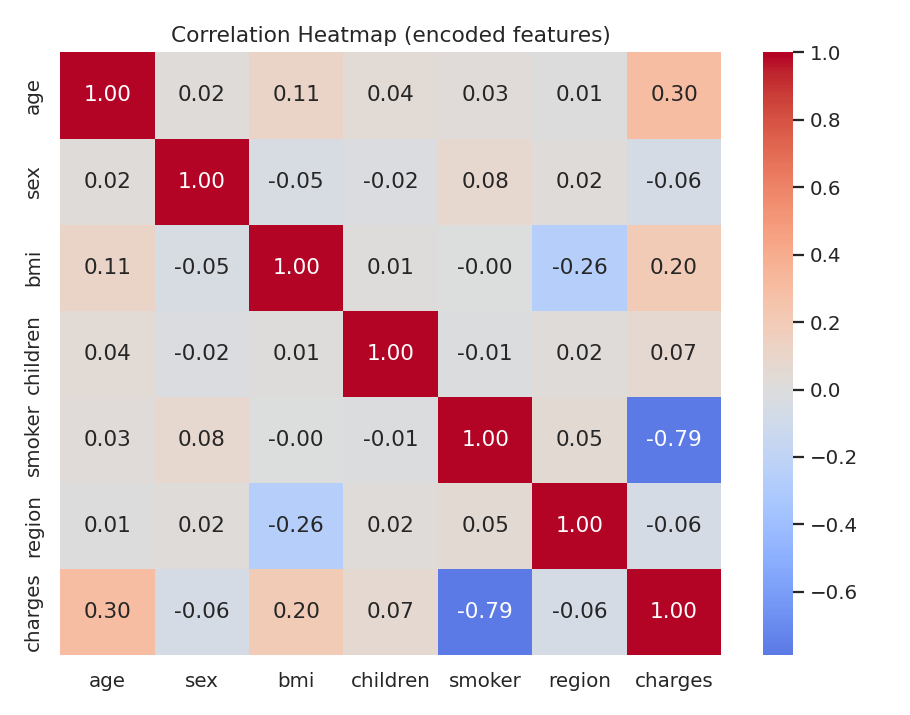
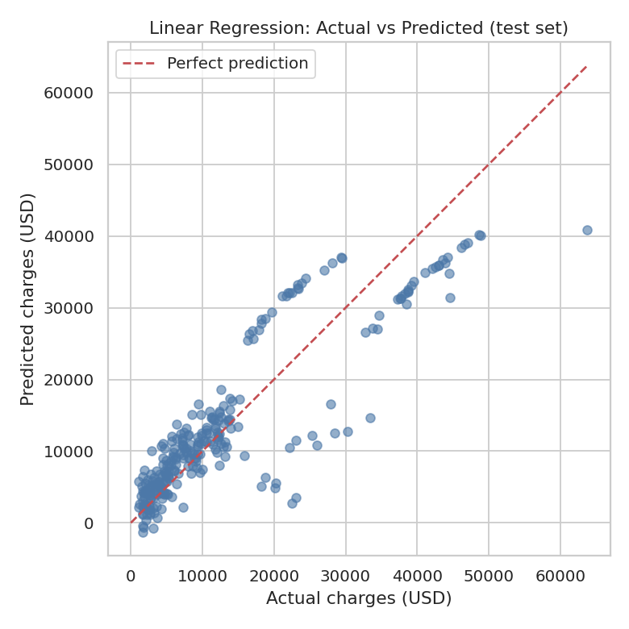

# 🏥 Medical Insurance Cost Prediction

Predicting yearly medical insurance charges from personal details (age, BMI, smoking status and more) using **Linear Regression** in Python.

   

## 📌 Project Overview

Insurance companies decide premiums using a person's profile. This project answers two questions:

1. **Which factors push insurance charges up the most?**
2. **Can we estimate a person's charges from their profile?**

I explored 1,338 insurance records, visualised each feature, encoded the categorical columns, and trained a regression model with a built-in prediction system that returns an estimated charge for any new person.

## 🔑 Key Findings

- **Smoking is the biggest driver of cost.** Smokers pay about **$32,050** on average vs **$8,434** for non-smokers, roughly **3.8x more**.
- **Smoking and high BMI together are the most expensive combination.** Smokers with BMI of 30 or above average about **$41,558**, compared to about **$21,363** for smokers below 30. For non-smokers, BMI makes only a small difference (about $8,843 vs $7,977).
- **Age matters, but less than smoking.** Charges rise steadily with age (correlation 0.30), and the scatter plot shows three clear price bands.
- **Sex and region have almost no effect** on charges (correlation about -0.06 each).
- Data quality is good: **no missing values**, balanced sex split, and evenly spread regions.

## 📊 Visuals

| Charges by smoking status | Age vs charges |
|:---:|:---:|
|  |  |

| Correlation heatmap | Actual vs predicted (test set) |
|:---:|:---:|
|  |  |

> Note: in the heatmap, `smoker` is encoded as yes = 0 and no = 1, so its correlation with charges shows as negative (-0.79). It means smokers pay more.

## 📂 Dataset

- **File:** `insurance.csv` (1,338 rows × 7 columns)
- **Source:** Kaggle, *Medical Cost Personal Datasets*

| Column | Description |
|---|---|
| `age` | Age of the primary beneficiary (18 to 64) |
| `sex` | male / female |
| `bmi` | Body mass index (16 to 53) |
| `children` | Number of dependents covered (0 to 5) |
| `smoker` | yes / no |
| `region` | US residential area: northeast, northwest, southeast, southwest |
| `charges` | Medical costs billed by insurance in USD (**target**) |

## ⚙️ Methodology

1. **Data checks:** shape, data types, missing values, summary statistics
2. **EDA:** distributions of age, sex, BMI, children, smoker, region and charges using Matplotlib and Seaborn
3. **Encoding:** categorical columns converted to numbers

   | Column | Mapping |
   |---|---|
   | `sex` | male = 0, female = 1 |
   | `smoker` | yes = 0, no = 1 |
   | `region` | southeast = 0, southwest = 1, northeast = 2, northwest = 3 |

4. **Train/test split:** 80% / 20% with `random_state=42` (1,070 train rows, 268 test rows)
5. **Model:** Linear Regression (scikit-learn)
6. **Predictive system:** enter a person's details and get an estimated insurance cost

## 📈 Model Performance

| Metric | Training | Testing |
|---|---|---|
| R² score | 0.741 | **0.783** |

On the test set the model's average error (MAE) is about **$4,190** and RMSE is about **$5,804**.

**How to read this:** the model explains about 78% of the variation in charges on unseen data. Test R² is slightly higher than train R², so there is no sign of overfitting. The remaining error comes mainly from the smoker × BMI interaction, which a plain linear model cannot capture (see Next Steps).

## 🧪 Example Prediction

```python
input_data = (19, 1, 27.900, 0, 0, 1)   # age, sex, bmi, children, smoker, region
prediction = regressor.predict(np.asarray(input_data).reshape(1, -1))
print("The insurance cost is USD", prediction[0])
```

A 19-year-old female smoker with BMI 27.9 and no children gets a predicted cost of about **$25,500** (the actual value in the dataset is about $16,885).

## 🛠️ Tech Stack

Python · Pandas · NumPy · Matplotlib · Seaborn · scikit-learn · Jupyter Notebook

## 📁 Repository Structure

```
medical-insurance-cost-prediction/
├── main.ipynb          # Full analysis and model
├── insurance.csv       # Dataset
├── images/             # Charts used in this README
├── README.md
├── LICENSE
└── .gitignore
```

## 🚀 How to Run

```bash
git clone https://github.com/aditya-datahub/medical-insurance-cost-prediction.git
cd medical-insurance-cost-prediction
pip install numpy pandas matplotlib seaborn scikit-learn jupyter
jupyter notebook main.ipynb
```

Keep `insurance.csv` in the same folder as the notebook.

## 🔮 Next Steps

- Add Random Forest and Gradient Boosting and compare R², MAE and RMSE
- Add a smoker × BMI interaction feature to capture the biggest cost jump
- Use one-hot encoding for `region` instead of numeric labels
- Add cross-validation for a more reliable score
- Log-transform `charges`, since it is right-skewed
- Deploy as a small Streamlit app

## 👤 Author

**Aditya Sharma** · Data Analyst (SQL · Python · Power BI)
[GitHub](https://github.com/aditya-datahub) · [LinkedIn](https://www.linkedin.com/in/aditya-sharma-data-analyst)
